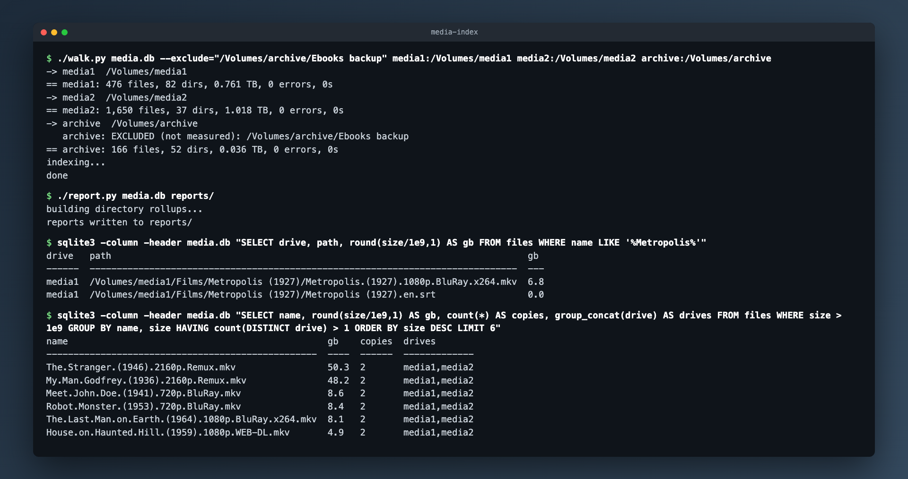

# media-index

A metadata-only indexer for a large media estate. It walks your drives, records every file's path, size, modification time and type into one SQLite database, and turns "do I own this?", "which drive is it on?" and "what is stored twice?" into SQL queries instead of another round of spinning up disks. It never hashes, never opens a file, and never moves, renames or deletes anything. On a real estate it indexed 2.16 million files (30.33 TB across ten drives) in about 13 minutes of walking, one process per drive.



*The screenshot is a run against the demo tree from `demo/make_demo_tree.py` (sparse files, public-domain titles), not anyone's real collection.*

## Features

- **Strictly read-only.** Only directory metadata (`os.scandir` + `stat`) is read. No hashing, no file contents, no writes outside the database.
- **Fast on spinning disks.** Depth-first `scandir`, batched inserts, no symlink following, never crosses into another filesystem. Run one process per physical drive and the spindles work in parallel.
- **Honest coverage.** Noisy trees (`.git`, `node_modules`, caches, old backups) are summarised as one row with a file count and total size rather than indexed file by file. `--exclude` marks a tree as deliberately not measured, and every report says so loudly instead of silently claiming coverage it does not have.
- **Rolled-up reports.** `report.py` writes Markdown: per-drive totals and top-level collections, what everything is by file type, films with likely duplicate titles and low-quality copies, TV series with missing seasons and episodes, music by album, directories over 50 GB, and cross-drive duplicates by filename plus exact size.
- **Your own collections.** Name path prefixes in a JSON config and `report.py` rolls each one up by series or sub-folder.

## Quick start

Requires Python 3.8+ and nothing else (the `sqlite3` CLI is handy for queries).

```sh
./walk.py media.db media1:/mnt/media1 media2:/mnt/media2   # label:path, as many as you like
./report.py media.db reports/                              # Markdown reports into reports/
sqlite3 media.db "SELECT drive, path, size FROM files WHERE name LIKE '%Metropolis%'"
```

To try it without touching real drives, build the demo tree first. Its files are sparse, so a couple of terabytes of "media" takes almost no disk space:

```sh
./demo/make_demo_tree.py /tmp/media-demo
./walk.py demo.db media1:/tmp/media-demo/media1 media2:/tmp/media-demo/media2 archive:/tmp/media-demo/archive
./report.py demo.db demo/out/
```

### Options

- `--exclude=<path>` (walk.py): do not descend into this tree and do not even count it. Use it for trees whose file count, not size, is the cost (half a million tiny ebook files, say). Reports flag it as not measured.
- `--config=<file>` (both): a JSON config. Without it, `media-index.local.json` next to the scripts is used if it exists. Copy [media-index.example.json](media-index.example.json) to start. It holds `skip_paths` (absolute paths summarised rather than indexed) and `collection_reports` (named path prefixes for the collection roll-ups).

### Many drives at once

Walk each physical drive in its own process, into its own database, then merge:

```sh
./walk.py media1.db media1:/mnt/media1 &
./walk.py media2.db media2:/mnt/media2 &
wait
cp media1.db media.db
for db in media2.db; do
  sqlite3 media.db "ATTACH '$db' AS s; INSERT INTO files SELECT * FROM s.files; INSERT INTO dirs SELECT * FROM s.dirs; INSERT INTO skipped SELECT * FROM s.skipped; INSERT INTO errors SELECT * FROM s.errors; INSERT INTO runs SELECT * FROM s.runs;"
done
```

## Schema

| Table | What |
|---|---|
| `files` | drive, path, parent, name, ext, size, mtime, depth: one row per file |
| `dirs` | every directory walked |
| `dirsizes` | recursive files and bytes per directory (built by `report.py` on first run) |
| `skipped` | subtrees noted but not indexed, with recursive count and size (`-1` = deliberately not measured) |
| `errors` | unreadable paths |
| `runs` | per-drive totals and walk duration |

`dirsizes` exists because a `LIKE d.path || '/%'` join is O(files × dirs) and never finishes at this scale; ancestor sizes are accumulated in a single pass instead, so reports build in seconds even at two million rows.

## Sample queries

```sql
-- do I own it, and where?
SELECT drive, path, size FROM files WHERE name LIKE '%Metropolis%';

-- biggest directories anywhere
SELECT drive, path, bytes/1e9 AS gb FROM dirsizes ORDER BY bytes DESC LIMIT 20;

-- whole collections stored more than once
SELECT name, files, bytes, count(*) n, group_concat(path, ' | ')
FROM dirsizes WHERE bytes > 5e9 GROUP BY name, files, bytes HAVING n > 1;
```

## Caveats

- Film, TV and album classification is filename based. DVD rips (`VIDEO_TS/VTS_01_1.VOB`) collide on generic names and produce false duplicate titles; real duplicates are the ones matched on filename and exact size.
- Duplicate detection is filename plus exact byte size, no hashing. Treat it as a candidate list for targeted hashing, not proof.

## Tech

Python 3 standard library (`os.scandir`, `sqlite3`, `json`). Reports are plain Markdown.

## Licence

MIT. See [LICENSE](LICENSE).
